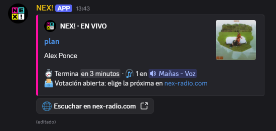
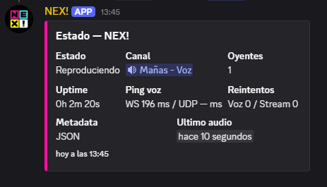
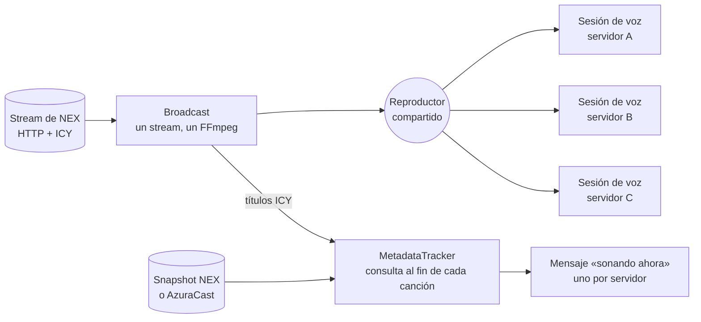

<p align="center">
  
</p>

<h1 align="center">NEX · bot de radio para Discord</h1>

<p align="center">
  Bot de Discord que transmite en canales de voz la radio en vivo de <a href="https://nex-radio.com">NEX</a>.
</p>

<p align="center">
  <a href="https://github.com/john-Mcan/discord-bot-nex/actions/workflows/ci.yml"></a>
  
  <a href="LICENSE"></a>
</p>

[NEX](https://nex-radio.com) es una radio en vivo donde la audiencia elige qué suena: vota por la
próxima canción desde la web. Este bot la lleva a Discord: lo llamas a tu canal de voz con `/play`,
transmite la señal en vivo y mantiene un mensaje «sonando ahora» con la canción, la portada, una
cuenta regresiva hasta el próximo tema, un enlace para votar cuando la votación está abierta y un
botón para escuchar en la web.

<!-- Captura del mensaje «sonando ahora»: se activa cuando exista docs/capturas/sonando-ahora.png
<p align="center">
  
</p>
-->

Está hecho con TypeScript, [discord.js](https://discord.js.org) 14,
[@discordjs/voice](https://github.com/discordjs/discord.js/tree/main/packages/voice) y FFmpeg
(incluido con [`ffmpeg-static`](https://github.com/eugeneware/ffmpeg-static)).

## Funciones

- **Un solo stream para todos los servidores.** Una conexión HTTP a la radio y un solo FFmpeg
  alimentan las sesiones de voz de todos los servidores, así sumar servidores no multiplica las
  conexiones ni el CPU.
- **Metadata en vivo.** Lee el snapshot del backend de NEX, la API de AzuraCast o cualquier JSON
  (con rutas configurables), y usa los títulos ICY del stream como respaldo. La consulta se programa
  para justo después del cambio de canción, con la hora del servidor de metadata.
- **Mensaje «sonando ahora» persistente.** Uno por servidor, que se edita en vez de repetirse: título
  enlazado, artista, portada adjunta (con el logo de respaldo), cuenta regresiva, oyentes, aviso de
  votación abierta y botón «Escuchar en nex-radio.com».
- **Reconexión con backoff.** Si se cae el stream o la voz, reintenta hasta 5 veces con espera
  exponencial (1,5 s a 24 s, con variación aleatoria) y avisa en el canal. Un watchdog detecta el
  stream que deja de entregar audio.
- **Sesiones cuidadas.** Se desconecta solo cuando el canal queda vacío, no permite que otra persona
  traslade el bot mientras hay oyentes (salvo con «Mover miembros») y detecta cuando lo sacan del
  canal a mano.
- **Operación.** Logs JSON estructurados, `/healthz` y métricas de Prometheus en `/metrics`, cooldown
  por comando e imagen Docker con healthcheck.

<!-- Captura de /status: se activa cuando exista docs/capturas/status.png
<p align="center">
  
</p>
-->

## Arquitectura



`RadioManager` es la fachada que usa `src/index.ts`: atiende los comandos y los eventos de voz y
conecta estos módulos de `src/radio/`:

| Módulo                  | Responsabilidad                                                                       |
| ----------------------- | ------------------------------------------------------------------------------------- |
| `Broadcast.ts`          | Stream HTTP compartido, reproductor y FFmpeg, watchdog y reconexión con backoff       |
| `VoiceSessions.ts`      | Una sesión de voz por servidor: conexión, reconexión, inactividad y cierre            |
| `MetadataTracker.ts`    | Canción actual (ICY o JSON), consulta al terminar cada canción y portada              |
| `metadata.ts`           | Extracción pura: rutas por puntos, AzuraCast, snapshot NEX y próxima consulta         |
| `icy.ts`                | Conexión al stream con redirecciones y separación de audio y títulos ICY              |
| `NowPlayingMessages.ts` | Mensaje persistente por servidor (crear o editar, espera de 300 ms) y avisos de texto |
| `nowPlayingView.ts`     | Embeds de «sonando ahora», radio desconectada y `/status`, botón y cuenta regresiva   |
| `artwork.ts`            | Descarga de portadas compartida entre servidores y logo de la radio                   |
| `presence.ts`           | Actividad del bot («Escuchando…»), con un cambio cada 10 s como máximo                |
| `backoff.ts`            | Esperas entre reintentos                                                              |
| `session.ts`            | Modelo de la sesión y su estado visible (voz + stream)                                |

## Requisitos

- Node.js 22.12 o superior (o Docker).
- Una aplicación de Discord con bot, creada en el
  [Developer Portal](https://discord.com/developers/applications). No necesita intents
  privilegiados.
- Permisos del bot: **Ver canal**, **Conectar** y **Hablar** en el canal de voz, y **Enviar
  mensajes**, **Insertar enlaces** y **Adjuntar archivos** en el canal de texto donde se usa `/play`.

FFmpeg viene con `ffmpeg-static`; no hace falta instalarlo aparte.

Para invitar el bot, reemplaza `TU_CLIENT_ID` en este enlace (incluye los permisos de arriba):

```text
https://discord.com/oauth2/authorize?client_id=TU_CLIENT_ID&scope=bot%20applications.commands&permissions=3197952
```

## Instalación

```bash
git clone https://github.com/john-Mcan/discord-bot-nex.git
cd discord-bot-nex
npm ci
```

Copia el archivo de ejemplo de variables y complétalo:

```bash
# Linux o macOS
cp .env.example .env
```

```powershell
# Windows (PowerShell; en cmd, copy .env.example .env)
Copy-Item .env.example .env
```

Registra los comandos de barra (una vez, y de nuevo si cambian), compila y arranca:

```bash
npm run deploy:commands
npm run build
npm start
```

Si `DEV_GUILD_ID` está definido, `deploy:commands` registra los comandos solo en ese servidor y
aparecen de inmediato; sin esa variable se registran de forma global.

> `npm ci` usa el `.npmrc` del repo, que activa `legacy-peer-deps` a propósito: `prism-media`
> declara `@discordjs/opus` como dependencia opcional y aquí no se instala, porque FFmpeg ya codifica
> Opus.

## Variables de entorno

| Variable                      | Uso                                                                 | Predeterminado                  |
| ----------------------------- | ------------------------------------------------------------------- | ------------------------------- |
| `DISCORD_TOKEN`               | Token del bot                                                       | Obligatoria                     |
| `DISCORD_CLIENT_ID`           | ID de la aplicación                                                 | Obligatoria                     |
| `RADIO_STREAM_URL`            | Stream HTTP o HTTPS (MP3 o AAC)                                     | Obligatoria                     |
| `DEV_GUILD_ID`                | Servidor donde registrar los comandos durante el desarrollo         | Registro global                 |
| `RADIO_NAME`                  | Nombre que muestran los mensajes                                    | `icy-name` del stream o `Radio` |
| `RADIO_WEBSITE_URL`           | Web de la radio: enlaza la canción y agrega el botón «Escuchar en…» | Sin enlace                      |
| `IDLE_DISCONNECT_MINUTES`     | Minutos con el canal vacío antes de desconectarse (1 a 1440)        | `5`                             |
| `COMMAND_COOLDOWN_SECONDS`    | Espera por usuario y comando (0 a 60)                               | `3`                             |
| `RADIO_METADATA_URL`          | Endpoint JSON de metadata                                           | API de AzuraCast inferida       |
| `RADIO_METADATA_TITLE_PATH`   | Ruta por puntos al título                                           | Autodetección                   |
| `RADIO_METADATA_ARTIST_PATH`  | Ruta por puntos al artista                                          | Autodetección                   |
| `RADIO_METADATA_ARTWORK_PATH` | Ruta por puntos a la portada                                        | Autodetección                   |
| `METADATA_POLL_SECONDS`       | Intervalo máximo entre consultas de metadata (5 a 300)              | `15`                            |
| `HEALTH_HOST`                 | Interfaz de `/healthz` y `/metrics`                                 | `127.0.0.1`                     |
| `HEALTH_PORT`                 | Puerto de `/healthz` y `/metrics`; `0` los desactiva                | `3000`                          |

Para NEX, `RADIO_METADATA_URL` apunta al snapshot del backend
(`https://api.nex-radio.com/api/radio/snapshot`), que trae la portada desde el CDN y los datos de
votación, y evita cargar a AzuraCast con las consultas del bot.

### Cómo se obtiene la metadata

- **Snapshot de NEX:** título, artista, portada (`cover_url`), fin de la canción (`ends_at_ms`),
  hora del servidor (`server_now_ms`), si la canción fue votada y si hay votación abierta.
- **AzuraCast:** `now_playing.song.*`, `played_at`, `duration` y `remaining`. Si el stream tiene la
  forma `/listen/<estación>/...`, el bot deduce el endpoint `/api/nowplaying/<estación>`.
- **Otros proveedores:** las tres variables `RADIO_METADATA_*_PATH` aceptan rutas por puntos (por
  ejemplo, `data.current.title`) y, si no se definen, se prueban las rutas más comunes.
- **ICY:** los títulos que vienen dentro del stream se usan cuando no hay JSON o cuando el JSON lleva
  más de dos intervalos sin responder.

La siguiente consulta se programa para el fin de la canción más 1,3 s: la canción nueva empieza 1 s
después del `ends_at` de la anterior y el backend la publica en ese instante. La cuenta regresiva
del mensaje llega a cero en el fin más 1 s, justo cuando cambia el audio.

## Comandos

| Comando            | Qué hace                                                                       |
| ------------------ | ------------------------------------------------------------------------------ |
| `/play` o `/radio` | Conecta el bot a tu canal de voz y reproduce la radio                          |
| `/stop` o `/leave` | Detiene la radio y desconecta el bot                                           |
| `/nowplaying`      | Muestra la canción actual                                                      |
| `/status`          | Muestra estado, canal, oyentes, uptime, ping de voz, reintentos y último error |

Para detener el bot hay que estar en su canal o tener **Mover miembros**. Nadie puede trasladarlo a
otro canal mientras haya oyentes, salvo con **Mover miembros**. Los canales Stage no están
soportados.

<!-- Captura de los comandos: se activa cuando exista docs/capturas/comandos.png
<p align="center">
  
</p>
-->

## Operación

`GET /healthz` responde `200` cuando el cliente de Discord está listo (`503` mientras arranca) e
incluye las métricas de la radio:

```json
{
  "status": "ok",
  "discordReady": true,
  "gatewayPingMs": 38,
  "sessions": 3,
  "playingSessions": 3,
  "reconnectingSessions": 0,
  "streamFailures": 1,
  "totalRetries": 1,
  "metadataUpdates": 148,
  "commands": { "play": 12, "nowplaying": 5, "status": 3, "stop": 2 }
}
```

`GET /metrics` expone lo mismo en formato Prometheus:

```text
# HELP discord_bot_nex_up Whether the Discord client is ready.
# TYPE discord_bot_nex_up gauge
discord_bot_nex_up 1
# HELP discord_bot_nex_gateway_ping_ms Discord gateway ping in milliseconds.
# TYPE discord_bot_nex_gateway_ping_ms gauge
discord_bot_nex_gateway_ping_ms 38
# TYPE discord_bot_nex_sessions gauge
discord_bot_nex_sessions 3
# TYPE discord_bot_nex_playing_sessions gauge
discord_bot_nex_playing_sessions 3
# TYPE discord_bot_nex_reconnecting_sessions gauge
discord_bot_nex_reconnecting_sessions 0
# TYPE discord_bot_nex_stream_failures_total counter
discord_bot_nex_stream_failures_total 1
# TYPE discord_bot_nex_stream_retries_total counter
discord_bot_nex_stream_retries_total 1
# TYPE discord_bot_nex_metadata_updates_total counter
discord_bot_nex_metadata_updates_total 148
discord_bot_nex_commands_total{command="play"} 12
discord_bot_nex_commands_total{command="nowplaying"} 5
discord_bot_nex_commands_total{command="status"} 3
discord_bot_nex_commands_total{command="stop"} 2
```

Los logs salen como un objeto JSON por línea, con `sessionId`, `guildId` y `voiceChannelId` cuando
corresponde:

```json
{
  "timestamp": "2026-10-31T16:15:30.031Z",
  "level": "info",
  "event": "stream.playing",
  "attempt": 1,
  "sessions": 3
}
```

## Despliegue

### Docker Compose (VPS)

La imagen se construye en dos etapas sobre `node:22-slim`, corre como un usuario sin privilegios e
incluye un `HEALTHCHECK` contra `/healthz`. `compose.yaml` lee el `.env` y publica `/healthz` y
`/metrics` solo en el loopback del servidor (`127.0.0.1:3000`).

```bash
cp .env.example .env        # y complétalo
docker compose build
docker compose run --rm bot node dist/deploy-commands.js   # registra los comandos
docker compose up -d
docker compose logs -f bot
```

Para actualizar: `git pull` y `docker compose up -d --build`.

### Railway

Railway construye la imagen con el `Dockerfile` del repo. Define las variables de entorno en el
panel del servicio (no subas el `.env`) y registra los comandos una vez desde tu equipo con
`npm run deploy:commands`. Si cambias el nombre de la rama que se despliega, actualízalo también en
la configuración del servicio.

### Sin Docker

```bash
npm ci
npm run build
npm prune --omit=dev
node dist/index.js
```

Déjalo bajo un gestor de procesos (systemd, PM2 u otro) que lo reinicie si se cae. El bot cierra
las sesiones de forma ordenada al recibir `SIGTERM` o `SIGINT`.

## Desarrollo

| Script              | Qué hace                                                      |
| ------------------- | ------------------------------------------------------------- |
| `npm run dev`       | Arranca con recarga automática (`tsx watch`)                  |
| `npm test`          | Corre todos los tests de `tests/` con el runner de Node       |
| `npm run lint`      | ESLint con typescript-eslint                                  |
| `npm run format`    | Formatea con Prettier                                         |
| `npm run typecheck` | Verifica los tipos de `src/` y `tests/` (`tsc --noEmit`)      |
| `npm run check`     | Lint, formato, tipos, tests y build: lo mismo que corre el CI |
| `npm run build`     | Compila a `dist/`                                             |

Los tests cubren la extracción de metadata, el cálculo de la próxima consulta y de la cuenta
regresiva, el backoff, la validación de variables, los mensajes, el ciclo de vida de las sesiones
(con un adaptador de voz falso) y una prueba de integración que transmite un MP3 con metadata ICY
por FFmpeg real, corta la conexión y comprueba que la transmisión se recupera.

```text
src/
  index.ts             Cliente de Discord, comandos, cooldown y apagado ordenado
  env.ts, parseEnv.ts  Carga y validación de variables de entorno
  health.ts            /healthz y /metrics
  healthcheck.ts       Healthcheck del contenedor
  radio/               Transmisión, sesiones, metadata y mensajes (ver Arquitectura)
tests/                 Tests con node:test
assets/                Logo de la radio
```

## Licencia

El código se publica bajo la [licencia MIT](LICENSE). El nombre NEX y su logo pertenecen a NEX y no
quedan cubiertos por esa licencia.
